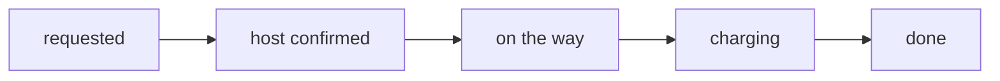

<div align="center">

# Ampere

**Find a charger your car can actually reach, and only travel once the host has said yes.**

A community EV charging network for India that combines public charger discovery with private charger sharing.
Built in 24 hours for the hackathon final · Pune · cars only.

`Next.js` · `TypeScript` · `Supabase` · `PostgreSQL` · `Leaflet`

</div>

<!-- Add a real screenshot or GIF of the driver results + Jury Console here, e.g. . Remove this comment if you don't have one; a broken image is worse than none. -->

> **Status:** hackathon MVP. All payments, charging sessions and host earnings are **simulated** and labelled *Demo* in the app. No real money moves and no real charger is controlled.

---

## The problem

Finding a pin on a map is the easy part for an EV driver at low battery. The harder questions come after: does the connector fit, can I reach it with the charge I have left, will I be let in, and is the slot actually free? Private chargers at homes, cafés and offices are often nearby, but there is no way to arrange access to them.

Ampere answers those questions before the driver moves.

## What it does

- **Shows only chargers you can use.** Every driver result has passed two checks: the connector matches the car, and the charger is within the car's estimated reachable range with a safety margin. Ineligible chargers are removed from both the map and the list. They are not just greyed out.
- **Requires host confirmation before you leave.** A community booking stays *requested* until the host accepts. The driver is never told to start driving before that.
- **Stores each booking as a sequence of events.** Every action is appended to an event log in the database, and the booking's state is rebuilt by replaying that log. Refreshing the page, clearing browser storage or reconnecting does not lose the booking.
- **Gives hosts control.** Hosts set their own schedules, accept or decline each request, and can see how their earnings are calculated.
- **Is honest when nothing fits.** If no charger is reliably reachable, the driver sees a clear empty state instead of a made-up option.

## Jury Console

The organisers' twist is built into the app itself, not a separate mock. The console is a plain-text input that calls the same booking services and database as the normal interface.

```text
TICKET|<car model>|<battery percent>|<lat>|<lon>|<connector>
READY|<booking ref>|<ISO time>
```

Example:

```text
TICKET|Tata Nexon EV|4|18.5362|73.8939|CCS2
```

**`TICKET`**
1. Resolves the car profile.
2. Applies the range calculation and safety margin.
3. Lists only the chargers that match.
4. Creates a real persisted booking request on a deterministic eligible community charger and prints its booking reference.

If no charger is eligible, it explains why and creates nothing.

**`READY`** appends a host-confirmation event to that booking and prints `host confirmed`. The console shows the current server time and a ready-to-copy `READY` line, so there is no need to guess the reference.

**What to check during judging**

1. At 4% battery, a charger beyond the range budget does not appear.
2. A nearby charger with the wrong connector does not appear and cannot be booked through `TICKET`.
3. `TICKET` prints a stored reference, and `READY` moves that same booking to *host confirmed*.
4. Refreshing the page, even after clearing site data, restores *host confirmed* by replaying events from the database.
5. The normal map, list and host buttons use the same filters and the same events.

In the demo, `READY` stands in for the host and is available only in a restricted jury session. Outside the demo, only the host or an approved operator can confirm a booking. Drivers can never confirm their own booking.

## Booking lifecycle

The app only ever displays these five states:



| Event appended | State after replay |
| --- | --- |
| Driver requests a slot | requested |
| Host accepts (button or `READY`) | host confirmed |
| Driver departs | on the way |
| Session starts | charging |
| Session completes | done |

Payment, check-in, decline, timeout and cancellation are recorded as events too, but they do not add new states. A declined or expired booking keeps its last state, shows a separate outcome notice, and has its journey actions disabled. Realtime updates deliver new events rather than overwritten status fields. On reconnect, the client fetches any events it missed and replays them.

The database keeps a rebuildable projection for search and overlap prevention. The event log remains the source of truth.

## How reachability is calculated

```text
usable energy above reserve = capacity × (battery % − reserve %)
range budget (km)           = usable energy ÷ (consumption × uncertainty multiplier)
```

For a 40 kWh car at 4% battery with a 2% reserve, consumption of 0.16 kWh/km and a multiplier of 1.25:
0.8 kWh ÷ 0.20 kWh/km = **4 km**.

Straight-line distance is only used to rule out chargers that are clearly too far. A charger counts as reachable only when its road-route distance is within budget. The reserve and multiplier are adjustable assumptions, not validated constants.

## Quick start

**Requirements:** Node.js 18+, a Supabase project (or the Supabase CLI for local development).

```bash
git clone <repo-url> && cd ampere
npm install
cp .env.example .env.local      # fill in the values below
npx supabase db push            # apply migrations
npm run seed                    # load demo + verified listing records
npm run dev
```
<!-- Check that these script names match package.json before submitting. -->

Open `http://localhost:3000`. To see live driver-to-host updates, sign in as the driver and as the host in two separate browser profiles.

| Variable | Used by |
| --- | --- |
| `NEXT_PUBLIC_SUPABASE_URL` | Client and server |
| `NEXT_PUBLIC_SUPABASE_ANON_KEY` | Client and server |
| `SUPABASE_SERVICE_ROLE_KEY` | **Server only.** Never exposed to the browser |

## Architecture

```text
Next.js app (driver · host · admin · Jury Console)
        │  server actions / route handlers validate every booking write
        ▼
Supabase ── Auth ── PostgreSQL (event log + projections, RLS) ── Realtime (new events)
        │
React Leaflet map  ·  searchable list view that works without map tiles
```

The map and the Jury Console call the same eligibility function and the same booking service. No path skips the server-side checks.

## Security and data handling

- **Row-level security** isolates each driver's bookings and each host's sites.
- **The service-role key is used only on the server.** `.env*` files are git-ignored, and no secrets are committed.
- **Booking writes are validated server-side.** The database enforces overlaps, so two drivers cannot hold the same charger for the same time.
- **Residential privacy.** Drivers see only an approximate area. The server uses exact coordinates to check reachability but never returns them. The exact entrance and host contact details are revealed only to a confirmed driver.
- **Payment confirmation.** A browser redirect or screenshot is never treated as proof of payment.

## What is real and what is simulated

| Real in this build | Simulated or deferred |
| --- | --- |
| Sign-in and role separation | Payments and refunds (labelled *Demo*) |
| Connector and range filtering | Energy delivered and session progress |
| Event-sourced bookings with replay | Host payouts |
| Host accept/decline with a 2-minute timeout | Live public-network status and reservations (needs operator agreements) |
| Double-booking prevention in the database | Electrical safety certification of host equipment |
| Jury Console writing to the real database | |

The location records used for the in-range and out-of-range jury cases are real listings. They are kept separate from labelled synthetic fixtures. A real location does not mean Ampere has permission to charge there.

## Repository layout
<!-- Update to match the actual tree. -->

```text
app/            routes: discovery, booking, host, admin, console
components/     UI (shadcn/ui + Tailwind)
lib/            eligibility, range estimate, booking events and replay
supabase/       migrations, RLS policies, seed data
docs/           solution document and demo script
```


The tests cover: range and connector exclusion, replay after refresh, event recovery after reconnect, host decline and timeout, concurrent double-booking attempts, access to another user's booking, and both console commands, including the no-match case.

## Known limitations

- Only cars are supported, and the vehicle catalogue is small and hand-reviewed.
- Range estimates depend on battery percentages entered by the driver.
- Live multi-user updates need an internet connection. A recorded demo video is the fallback.
- Pricing (₹14/kWh, ₹20 Standard fee) is a hypothesis that needs tariff and regulatory review before any real launch.
